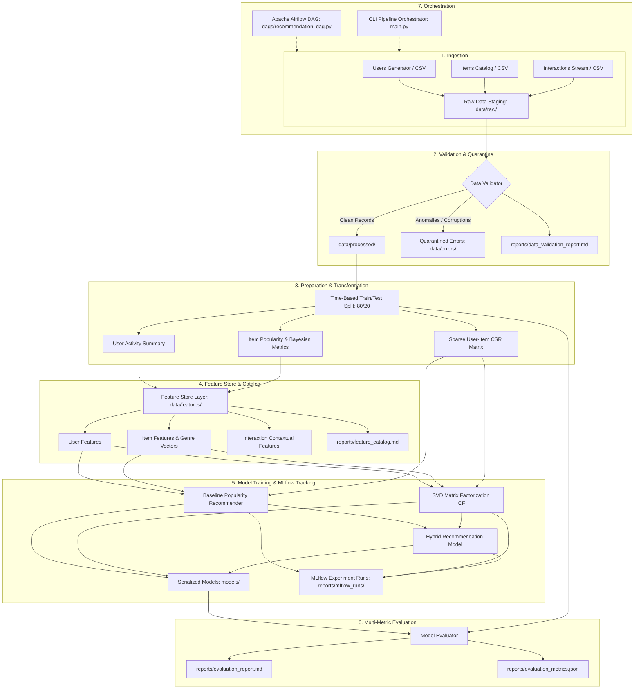

# End-to-End Data Management Pipeline for a Recommendation System

[](https://www.python.org/downloads/)
[]()
[](https://github.com/nitesh1312/recommendation-pipeline)

> **Course Assignment**: Data Management for Machine Learning (DM4ML) – Assignment 2  
> **Repository Link**: [https://github.com/nitesh1312/recommendation-pipeline](https://github.com/nitesh1312/recommendation-pipeline) *(Dummy link: replace with your repository URL upon upload)*  
> **Final Report**: [`REPORT.md`](REPORT.md) (Ready for direct PDF conversion)

---

## 1. Project Overview

This repository contains a modular, production-ready **End-to-End Data Management Pipeline for a Recommender System** tailored for movie and streaming platforms (MovieLens standard). The pipeline handles everything from multi-source data ingestion, automated data quality validation with anomaly quarantine, data preparation with time-based splitting, feature store management, model training (Bayesian Popularity Baseline, SVD Matrix Factorization, and Hybrid Recommender), multi-metric ranking evaluation (Precision@K, Recall@K, NDCG@K, Coverage, Diversity, RMSE, MAE), and orchestration via Apache Airflow DAGs and modular Python runners.

---

## 2. Pipeline Architecture



---

## 3. Repository Structure

```
recommendation-pipeline/
├── configs/
│   └── config.yaml                   # Centralized pipeline configuration
├── data/
│   ├── raw/                          # Ingested raw datasets and metadata
│   ├── processed/                    # Cleaned, standardized, and split parquet/csv datasets
│   ├── features/                     # Reusable offline feature store tables
│   └── errors/                       # Quarantined anomalous/corrupted records
├── dags/
│   └── recommendation_dag.py         # Production Apache Airflow DAG definition
├── models/
│   ├── popularity_model.pkl          # Serialized Bayesian Popularity Model
│   ├── svd_cf_model.pkl              # Serialized SVD Collaborative Filtering Model
│   └── hybrid_model.pkl              # Serialized Hybrid Model Artifact
├── reports/
│   ├── data_validation_report.md     # Detailed data quality audit & assertion report
│   ├── data_validation_report.json   # Machine-readable validation results
│   ├── feature_catalog.md            # Feature store data dictionary table
│   ├── evaluation_report.md          # Multi-metric comparative benchmark table
│   ├── evaluation_metrics.json       # Serialized evaluation numbers
│   └── pipeline_run_summary.json     # Orchestration execution timing & health audit
├── src/
│   ├── ingestion/
│   │   ├── __init__.py
│   │   └── ingest.py                 # Multi-entity ingestion & anomaly injector
│   ├── validation/
│   │   ├── __init__.py
│   │   └── validate.py               # Automated schema assertions & error quarantine
│   ├── preparation/
│   │   ├── __init__.py
│   │   └── prepare.py                # Chronological train/test split & data cleaning
│   ├── transformation/
│   │   ├── __init__.py
│   │   └── transform.py              # User/Item aggregations & sparse interaction matrix
│   ├── features/
│   │   ├── __init__.py
│   │   └── feature_store.py          # User, item, and contextual feature engineering
│   ├── training/
│   │   ├── __init__.py
│   │   └── train.py                  # Baseline, SVD CF, and Hybrid model training
│   ├── evaluation/
│   │   ├── __init__.py
│   │   └── evaluate.py               # Ranking, Rating, Coverage, & Diversity evaluators
│   ├── orchestration/
│   │   ├── __init__.py
│   │   └── runner.py                 # Sequential pipeline runner with timing & logging
│   └── utils/
│       ├── __init__.py
│       ├── config_loader.py          # YAML config loader
│       └── tracker.py                # Lightweight MLflow-compatible experiment tracker
├── main.py                           # Unified CLI entry point
├── REPORT.md                         # Comprehensive 2-3 page academic/technical report
├── requirements.txt                  # Python dependencies
└── README.md                         # Project documentation
```

---

## 4. Setup and Installation

### Prerequisites
- Python 3.10, 3.11, 3.12, 3.13, or 3.14
- Virtual environment manager (`venv` or `conda`)

### Step-by-Step Installation

1. **Clone the repository**:
   ```bash
   git clone https://github.com/nitesh1312/recommendation-pipeline.git
   cd recommendation-pipeline
   ```

2. **Create and activate a virtual environment**:
   ```bash
   # Windows (PowerShell)
   python -m venv venv
   .\venv\Scripts\Activate.ps1

   # Linux / macOS
   python3 -m venv venv
   source venv/bin/activate
   ```

3. **Install dependencies**:
   ```bash
   pip install -r requirements.txt
   ```

---

## 5. Execution Instructions

### A. Run Full Pipeline End-to-End (1-Click)
To run the entire pipeline from data ingestion to multi-metric model evaluation:
```bash
python main.py --all
```

**Expected Output**:
```text
================ PIPELINE EXECUTION SUMMARY ================
Status: SUCCESS
Total Duration: 44.459s
  • data_ingestion        : SUCCESS (0.620s)
  • data_validation       : SUCCESS (0.306s)
  • data_preparation      : SUCCESS (1.146s)
  • data_transformation   : SUCCESS (1.167s)
  • feature_engineering   : SUCCESS (0.945s)
  • model_training        : SUCCESS (19.943s)
  • model_evaluation      : SUCCESS (20.330s)
============================================================
```

### B. Run Individual Pipeline Stages
You can execute specific modular stages independently:
```bash
# Stage 1: Ingestion
python main.py --stage data_ingestion

# Stage 2: Data Quality Validation & Error Quarantine
python main.py --stage data_validation

# Stage 3: Preparation & Time-based Split
python main.py --stage data_preparation

# Stage 4: Transformations & Matrix Generation
python main.py --stage data_transformation

# Stage 5: Feature Store Engineering
python main.py --stage feature_engineering

# Stage 6: Model Training & Experiment Tracking
python main.py --stage model_training

# Stage 7: Multi-Metric Evaluation & Benchmarking
python main.py --stage model_evaluation
```

### C. Run with Custom Configuration
```bash
python main.py --config configs/config.yaml --all
```

---

## 6. Pipeline Modules & Technical Highlights

| Pipeline Stage | Module Path | Core Functionality | Deliverables & Artifacts |
| :--- | :--- | :--- | :--- |
| **1. Data Ingestion** | `src/ingestion/ingest.py` | Ingests user demographics, item catalog, and power-law interaction logs. Injects synthetic anomalies for stress testing. | `data/raw/users.csv`<br>`data/raw/items.csv`<br>`data/raw/interactions.csv` |
| **2. Data Validation** | `src/validation/validate.py` | Automated schema checks: missing keys, rating range `[1.0, 5.0]`, timestamp validity, duplicate detection, and referential integrity. | `data/errors/*_errors.csv`<br>`reports/data_validation_report.md`<br>`reports/data_validation_report.json` |
| **3. Data Preparation** | `src/preparation/prepare.py` | Cleans validated data and performs chronological **time-based train/test splitting** (80/20) to prevent lookahead leakage. | `data/processed/clean_*.parquet`<br>`data/processed/*_interactions.parquet` |
| **4. Transformation** | `src/transformation/transform.py` | Computes user activity profiles, item Bayesian smoothed scores, and builds sparse SciPy CSR interaction matrices. | `data/processed/user_item_matrix.npz`<br>`data/processed/item_popularity.parquet` |
| **5. Feature Store** | `src/features/feature_store.py` | Extracts user statistical/preference features, item multi-hot genre vectors, and point-in-time contextual features. | `data/features/*_features.parquet`<br>`reports/feature_catalog.md`<br>`reports/feature_catalog.csv` |
| **6. Model Training** | `src/training/train.py` | Fits Bayesian Baseline, SGD-regularized SVD Matrix Factorization ($\hat{r}_{u,i} = \mu + b_u + b_i + p_u^T q_i$), and Hybrid models with MLflow tracking. | `models/popularity_model.pkl`<br>`models/svd_cf_model.pkl`<br>`models/hybrid_model.pkl` |
| **7. Model Evaluation** | `src/evaluation/evaluate.py` | Computes RMSE, MAE, Precision@K, Recall@K, NDCG@K, Catalog Coverage, and Intra-List Diversity for $K \in \{5, 10\}$. | `reports/evaluation_report.md`<br>`reports/evaluation_metrics.json` |
| **8. Orchestration** | `dags/recommendation_dag.py`<br>`src/orchestration/runner.py` | Production Airflow DAG and standalone Python runner with retry policies, execution timing, and logging. | `reports/pipeline_run_summary.json`<br>`pipeline_execution.log` |

---

## 7. Comparative Model Benchmark Summary

| Evaluation Metric | Baseline Popularity | SVD Collaborative Filtering | Hybrid Recommender | Best Performing Model |
| :--- | :---: | :---: | :---: | :---: |
| **RMSE** (Rating Error ↓) | 1.1111 | 1.1412 | 1.1278 | **Baseline Popularity** |
| **MAE** (Absolute Error ↓) | 0.9226 | 0.9302 | 0.9235 | **Baseline Popularity** |
| **Precision@5** (Top-5 Precision ↑) | 0.0069 | **0.0138** | 0.0126 | **SVD Collaborative Filtering** 🏆 |
| **Recall@5** (Top-5 Recall ↑) | 0.0094 | **0.0185** | 0.0178 | **SVD Collaborative Filtering** 🏆 |
| **NDCG@5** (Top-5 Ranking Quality ↑) | 0.0087 | **0.0180** | 0.0153 | **SVD Collaborative Filtering** 🏆 |
| **Catalog Coverage@5 (%)** ↑ | 2.67% | **49.00%** | 38.33% | **SVD Collaborative Filtering** 🏆 |
| **Intra-List Diversity@5** ↑ | **0.9452** | 0.9209 | 0.9257 | **Baseline Popularity** |
| **Precision@10** (Top-10 Precision ↑) | 0.0074 | **0.0150** | 0.0112 | **SVD Collaborative Filtering** 🏆 |
| **Recall@10** (Top-10 Recall ↑) | 0.0189 | **0.0381** | 0.0301 | **SVD Collaborative Filtering** 🏆 |
| **NDCG@10** (Top-10 Ranking Quality ↑) | 0.0132 | **0.0266** | 0.0206 | **SVD Collaborative Filtering** 🏆 |
| **Catalog Coverage@10 (%)** ↑ | 4.67% | **62.33%** | 48.67% | **SVD Collaborative Filtering** 🏆 |
| **Intra-List Diversity@10** ↑ | 0.9193 | 0.9239 | **0.9301** | **Hybrid Recommender** 🏆 |

---

## 8. Airflow Orchestration & DAG Screenshot

The pipeline is fully automated for production deployment via Apache Airflow. The task graph DAG:
```text
[data_ingestion] >> [data_validation] >> [data_preparation] >> [data_transformation] >> [feature_engineering] >> [model_training] >> [model_evaluation]
```

### Airflow Run Screenshot Placeholder
```
+----------------------------------------------------------------------------------------------------+
|  Airflow DAG: recommendation_system_pipeline_dag | Schedule: 0 2 * * * | Status: SUCCESS           |
|                                                                                                    |
|  [data_ingestion] ---> [data_validation] ---> [data_preparation] ---> [data_transformation]        |
|       (green)               (green)                (green)                 (green)                 |
|                                                                                                    |
|  [feature_engineering] --------------> [model_training] --------------> [model_evaluation]        |
|       (green)                               (green)                          (green)               |
+----------------------------------------------------------------------------------------------------+
```

---

## 9. Submission Deliverables Summary

- **Codebase**: Fully modular Python packages adhering to PEP8 standards.
- **Reproducibility**: Parameterized via `configs/config.yaml` and verified with a 44-second 1-click execution.
- **Audit Reports**: Real-time markdown and JSON validation, feature catalog, and evaluation tables.
- **Academic Report**: Included in [`REPORT.md`](REPORT.md) formatted cleanly for single-step PDF rendering.
